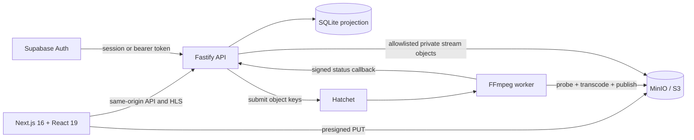

# Frameflow

**A local-first AI video publishing platform with a production-shaped media pipeline.**

[](https://github.com/BereketAbera/frameflow/actions/workflows/ci.yml)


Frameflow turns an uploaded MP4 into a private adaptive HLS stream, then wraps the processing pipeline in a polished creator studio and AI-video community experience. It combines a Next.js/React product UI, optional Supabase authentication, a Fastify API, direct S3-compatible uploads, Hatchet orchestration, parallel FFmpeg transcoding, and Video.js playback.

This repository is intentionally local-first: every service can be run and demonstrated on one machine while preserving the boundaries needed for a hosted architecture.

- [Five-minute portfolio walkthrough](docs/portfolio-guide.md)
- [UI system and component conventions](docs/ui-system.md)
- [Curated AI-film sourcing notes](docs/curated-ai-videos.md)

## What this project demonstrates

- **Product engineering:** responsive landing, discovery, studio, library, profiles, activity, publishing, and watch experiences built with Next.js 16, React 19, TypeScript, Tailwind CSS v4, and repository-owned shadcn/ui-style components.
- **Media engineering:** ffprobe validation, bounded parallel 360p/720p FFmpeg transcodes, master-last HLS publication, and Video.js 10 playback with Auto/manual quality selection.
- **Distributed workflows:** Hatchet coordinates probing, fan-out transcoding, retry-safe publication, failures, and signed status callbacks.
- **Secure service design:** presigned direct uploads, private object storage, owner-scoped records, allowlisted stream paths, authenticated callbacks, and optional Supabase sessions.
- **Operational thinking:** health/readiness checks, reconciliation, abandoned-upload expiry, staging cleanup, isolated worker scratch space, idempotency, and deterministic end-to-end verification.
- **Intentional delivery history:** the Git log preserves the project’s evolution from processing POC to full React product instead of collapsing it into one showcase commit.

## Product highlights

### Creator studio

- Drag-and-drop MP4 uploads with direct-to-storage progress.
- Live upload, queue, transcode, and publish states.
- Searchable, owner-scoped video library with safe terminal deletion.
- Publishing metadata, visibility controls, and creator profiles.
- System diagnostics for API, database, storage, and workflow readiness.

### Adaptive video pipeline

- Short-lived presigned uploads keep media bytes off the API server.
- Hatchet fans out independent 360p and 720p FFmpeg work.
- Each worker run uses an isolated scratch directory and object keys only.
- Renditions publish before the master playlist, preventing incomplete streams.
- Video.js 10 uses the official hls.js adapter and exposes Auto, 360p, and 720p selection when the manifest supports them.

### Discovery and community

- Landing page and searchable AI-video discovery feed.
- Public watch pages with views, likes, saves, comments, tags, and sharing.
- Saved-video library, playlists, notifications, and creator pages.
- Ten attributed, externally linked AI-film selections; Frameflow does not rehost the original works.

## Architecture



Hatchet is the workflow-execution source of truth. SQLite is the product-facing projection used for polling and local queries. Supabase owns identity when configured; Frameflow verifies sessions and applies the user ID to every video lookup and mutation.

### Media flow

```text
Browser
  -> API creates upload record and presigned URL
  -> Browser uploads MP4 directly to private object storage
  -> API validates object size and submits Hatchet workflow
  -> Worker probes source and transcodes 360p + 720p in parallel
  -> Worker stages renditions, publishes them, then publishes master.m3u8
  -> API projects terminal state and serves allowlisted HLS objects
  -> Video.js plays the adaptive stream through the hls.js adapter
```

## Technology

| Layer | Technology |
| --- | --- |
| Web application | Next.js 16 App Router, React 19, TypeScript |
| UI | Tailwind CSS v4, local shadcn/ui-style primitives, Lucide icons |
| Playback | Video.js 10 React, official hls.js adapter |
| API | Fastify 5, Zod validation |
| Authentication | Supabase Auth, optional in local development |
| Workflow orchestration | Hatchet TypeScript SDK |
| Media processing | FFmpeg and ffprobe |
| Object storage | MinIO locally; AWS S3-compatible contract |
| Local persistence | SQLite |
| Testing and delivery | Vitest, deterministic E2E smoke test, GitHub Actions |

## Quick start

### Prerequisites

- Node.js 24+
- npm
- Docker
- FFmpeg and ffprobe
- Hatchet Cloud or a self-hosted Hatchet instance

### Install

```bash
git clone https://github.com/BereketAbera/frameflow.git
cd frameflow
npm install
cp .env.example .env
```

Set `HATCHET_CLIENT_TOKEN` in `.env`, then initialize the local infrastructure:

```bash
npm run infra:up
npm run db:init
npm run doctor
```

Start the three application processes in separate terminals:

```bash
npm run worker
npm run api
npm run dev
```

Open [http://127.0.0.1:3000](http://127.0.0.1:3000).

MinIO defaults to `http://127.0.0.1:9000` with its console on port `9001`. If those ports are occupied, set `MINIO_API_PORT`, `MINIO_CONSOLE_PORT`, and the matching `S3_ENDPOINT` in `.env` before starting the infrastructure.

### Authentication modes

- With `SUPABASE_URL` and `SUPABASE_ANON_KEY` unset, Frameflow runs as a single `local-development` user.
- With both values configured, the app enables email/password sign-in and sign-up through Supabase and establishes an HTTP-only, same-site application session.
- Never put a Supabase service-role key in this project; only the public anon key belongs in `SUPABASE_ANON_KEY`.

## Local routes

| Route | Purpose |
| --- | --- |
| `/` | Product landing page |
| `/discover` | Searchable AI-video feed |
| `/studio` | Upload and creator workspace |
| `/player/[id]` | Owner view, processing state, and private playback |
| `/watch/[id]` | Public watch and community interactions |
| `/studio/edit/[id]` | Publishing metadata and visibility |
| `/library` | Saved videos and playlists |
| `/profile/[id]` | Creator profile |
| `/notifications` | Activity center |
| `/system` | Local service diagnostics |

## End-to-end demonstration

With MinIO, the API, the worker, and Next.js running:

```bash
npm run e2e:local
```

The command generates a deterministic 1280×720 fixture when no input is provided, creates a presigned upload, transfers the source, submits the Hatchet workflow, waits for completion, verifies both rendition playlists and a segment, publishes social metadata, checks the watch API, and prints the resulting URL.

Set `E2E_CLEANUP=true` to remove the generated video and objects after verification.

## Verification

```bash
npm run verify
npm audit
```

`npm run verify` executes TypeScript validation, the Vitest suite, and a production Next.js build. The current suite covers authentication and cross-user isolation, upload validation and idempotency, private HLS allowlisting, storage readiness, isolated worker scratch space, bounded staged uploads, master-last publication, reconciliation, cleanup, terminal transitions, curated-film data, and playable FFmpeg output.

The checked-in GitHub Actions workflow runs the same verification and a high-severity dependency audit on pushes and pull requests.

## Storage and publication

```text
videos/{videoId}/source/source.mp4
videos/{videoId}/staging/{workflowRunId}/{360p|720p}/...
videos/{videoId}/published/{360p|720p}/...
videos/{videoId}/published/master.m3u8
```

Renditions upload to a run-specific staging prefix. Publication copies rendition objects first and uploads the master playlist last. The operation is retry-safe after partial copying or cleanup, and successful publication removes its staging prefix.

The bucket remains private. Playback goes through the API, which requires a completed record and only serves the master playlist, known rendition playlists, and numbered transport-stream segments under the record’s published prefix.

## Reliability and maintenance

```bash
npm run reconcile
npm run cleanup          # dry-run only
npm run cleanup -- --apply
```

- Reconciliation inspects stale queued and processing records with Hatchet run IDs and repairs known terminal drift.
- Cleanup expires abandoned presigned uploads and removes stale staging prefixes and worker scratch directories.
- Status transitions are monotonic: `uploading -> uploaded -> queued -> processing -> completed|failed`.
- Upload confirmation is idempotent, and concurrent confirmations coalesce into one workflow submission.

For the retry demonstration, start the API with `FORCE_720P_FAILURE_ONCE=true`. The workflow intentionally fails the first 720p attempt and succeeds on retry without rerunning completed parents.

## Configuration reference

| Variable | Default | Purpose |
| --- | --- | --- |
| `PORT` | `4000` | Fastify API port |
| `API_ORIGIN` | `http://127.0.0.1:4000` | Next.js API rewrite target |
| `DATABASE_PATH` | `./data/app.db` | Local SQLite projection |
| `S3_ENDPOINT` | `http://127.0.0.1:9000` | S3-compatible endpoint |
| `S3_REGION` | `us-east-1` | Object-storage region |
| `S3_BUCKET` | `frameflow` | Private media bucket |
| `S3_FORCE_PATH_STYLE` | `true` | Required for local MinIO |
| `S3_PRESIGNED_UPLOAD_TTL_SECONDS` | `600` | Upload URL lifetime |
| `MAX_UPLOAD_BYTES` | `524288000` | Maximum source size |
| `MAX_CONCURRENT_ENCODES` | `2` | Per-worker FFmpeg limit |
| `WORKER_TEMP_DIR` | `./.worker-tmp` | Disposable worker scratch root |
| `STATUS_CALLBACK_BASE_URL` | `http://127.0.0.1:4000` | Worker callback target |
| `WORKER_CALLBACK_SECRET` | development value | Callback authentication |
| `SUPABASE_URL` | unset | Enables Supabase when paired with anon key |
| `SUPABASE_ANON_KEY` | unset | Supabase public browser key |

For AWS S3, omit `S3_ENDPOINT`, provide the appropriate credentials and region, and normally set `S3_FORCE_PATH_STYLE=false`.

## Current limits and hosting path

- SQLite is intentionally a single-node local persistence choice; a hosted version should use managed Postgres.
- The FFmpeg semaphore is per worker process rather than distributed.
- Stronger content inspection, resumable multipart uploads, CDN delivery, object lifecycle policies, and distributed admission control remain future work.
- A Vercel deployment can host the Next.js application, while the Fastify API, Hatchet worker, durable database, and object storage require persistent infrastructure.
- Chromium desktop and responsive mobile playback are verified locally; production release should add a real iOS Safari device pass.

## Delivery history

The commit history is part of the project narrative:

1. Phase 1 established the Hatchet/FFmpeg DAG and retry behavior.
2. Phase 2 added the Fastify API, SQLite status projection, safe HLS proxy, and reconciliation.
3. Phase 3 removed shared-filesystem coupling with S3-compatible storage, direct uploads, isolated scratch space, staging publication, and cleanup.
4. The product layer added Supabase identity, per-user authorization, the complete upload workspace, processing UX, and polished playback.
5. The frontend migration separated the product into a Next.js/React application and a focused Fastify API with same-origin proxying.
6. Discovery and social features turned the processing POC into an AI-video community product.
7. Playback moved to Video.js 10 with the official hls.js adapter and adaptive-quality controls.

Run `git log --oneline --reverse` to walk through the implementation story, then follow the [portfolio walkthrough](docs/portfolio-guide.md) for a concise live demo.
