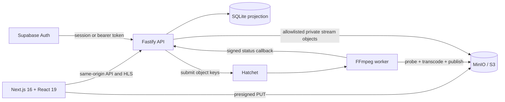

# Frameflow

**A local-first AI video publishing platform with a production-shaped media pipeline.**

[](https://github.com/BereketAbera/frameflow/actions/workflows/ci.yml)


Frameflow turns an uploaded MP4 into a private adaptive HLS stream, then wraps the processing pipeline in a polished creator studio and AI-video community experience. It combines a Next.js/React product UI, optional Supabase authentication, a Fastify API, direct S3-compatible uploads, Hatchet orchestration, parallel FFmpeg transcoding, and Video.js playback.

This repository is intentionally local-first: every service can be run and demonstrated on one machine while preserving the boundaries needed for a hosted architecture.

- [Five-minute portfolio walkthrough](docs/portfolio-guide.md)
- [UI system and component conventions](docs/ui-system.md)
- [Curated AI-film sourcing notes](docs/curated-ai-videos.md)

## What this project demonstrates

- **Product engineering:** responsive landing, discovery, studio, library, profiles, activity, publishing, and watch experiences built with Next.js 16, React 19, TypeScript, Tailwind CSS v4, and repository-owned shadcn/ui-style components.
- **Media engineering:** ffprobe validation, bounded parallel 360p/720p FFmpeg transcodes, master-last HLS publication, and Video.js 10 playback with Auto/manual quality selection.
- **Distributed workflows:** Hatchet coordinates probing, fan-out transcoding, retry-safe publication, failures, and signed status callbacks.
- **Secure service design:** presigned direct uploads, private object storage, owner-scoped records, allowlisted stream paths, authenticated callbacks, and optional Supabase sessions.
- **Operational thinking:** health/readiness checks, reconciliation, abandoned-upload expiry, staging cleanup, isolated worker scratch space, idempotency, and deterministic end-to-end verification.
- **Intentional delivery history:** the Git log preserves the project’s evolution from processing POC to full React product instead of collapsing it into one showcase commit.

## Product highlights

### Creator studio

- Drag-and-drop MP4 uploads with direct-to-storage progress.
- Live upload, queue, transcode, and publish states.
- Searchable, owner-scoped video library with safe terminal deletion.
- Publishing metadata, visibility controls, and creator profiles.
- System diagnostics for API, database, storage, and workflow readiness.

### Adaptive video pipeline

- Short-lived presigned uploads keep media bytes off the API server.
- Hatchet fans out independent 360p and 720p FFmpeg work.
- Each worker run uses an isolated scratch directory and object keys only.
- Renditions publish before the master playlist, preventing incomplete streams.
- Video.js 10 uses the official hls.js adapter and exposes Auto, 360p, and 720p selection when the manifest supports them.

### Discovery and community

- Landing page and searchable AI-video discovery feed.
- Public watch pages with views, likes, saves, comments, tags, and sharing.
- Saved-video library, playlists, notifications, and creator pages.
- Ten attributed, externally linked AI-film selections; Frameflow does not rehost the original works.

## Architecture



Hatchet is the workflow-execution source of truth. SQLite is the product-facing projection used for polling and local queries. Supabase owns identity when configured; Frameflow verifies sessions and applies the user ID to every video lookup and mutation.

### Media flow

```text
Browser
  -> API creates upload record and presigned URL
  -> Browser uploads MP4 directly to private object storage
  -> API validates object size and submits Hatchet workflow
  -> Worker probes source and transcodes 360p + 720p in parallel
  -> Worker stages renditions, publishes them, then publishes master.m3u8
  -> API projects terminal state and serves allowlisted HLS objects
  -> Video.js plays the adaptive stream through the hls.js adapter
```

## Technology

| Layer | Technology |
| --- | --- |
| Web application | Next.js 16 App Router, React 19, TypeScript |
| UI | Tailwind CSS v4, local shadcn/ui-style primitives, Lucide icons |
| Playback | Video.js 10 React, official hls.js adapter |
| API | Fastify 5, Zod validation |
| Authentication | Supabase Auth, optional in local development |
| Workflow orchestration | Hatchet TypeScript SDK |
| Media processing | FFmpeg and ffprobe |
| Object storage | MinIO locally; AWS S3-compatible contract |
| Local persistence | SQLite |
| Testing and delivery | Vitest, deterministic E2E smoke test, GitHub Actions |

## Quick start

### Prerequisites

- Node.js 24+
- npm
- Docker
- FFmpeg and ffprobe
- Hatchet Cloud or a self-hosted Hatchet instance

### Install

```bash
git clone https://github.com/BereketAbera/frameflow.git
cd frameflow
npm install
cp .env.example .env
```

Set `HATCHET_CLIENT_TOKEN` in `.env`, then initialize the local infrastructure:

```bash
npm run infra:up
npm run db:init
npm run doctor
```

Start the three application processes in separate terminals:

```bash
npm run worker
npm run api
npm run dev
```

Open [http://127.0.0.1:3000](http://127.0.0.1:3000).

MinIO defaults to `http://127.0.0.1:9000` with its console on port `9001`. If those ports are occupied, set `MINIO_API_PORT`, `MINIO_CONSOLE_PORT`, and the matching `S3_ENDPOINT` in `.env` before starting the infrastructure.

### Authentication modes

- With `AUTH_MODE`, `SUPABASE_URL` and `SUPABASE_ANON_KEY` unset, Frameflow runs as a single `local-development` user.
- With both Supabase values configured, the app enables email/password sign-in and sign-up through Supabase and establishes an HTTP-only, same-site application session. `AUTH_MODE=supabase` makes those values mandatory.
- `AUTH_MODE=owner` is for a public demo: visitors can browse the feed, watch pages, profiles and public streams but cannot upload, delete, comment, like, save or see private videos. Only the holder of the owner access key can use the studio (see below). It cannot be combined with Supabase, and the API refuses to start if it is misconfigured.
- Never put a Supabase service-role key in this project; only the public anon key belongs in `SUPABASE_ANON_KEY`.

### Owner access key

The API stores only the key's SHA-256 digest. Signing in exchanges the key for an expiring, HMAC-signed `vp_session` cookie, so the browser never stores the key itself.

```bash
umask 077                                                           # key files readable only by you
openssl rand -base64 32 | tr -d '\n' > ~/.frameflow-owner-key       # the owner access key
shasum -a 256 ~/.frameflow-owner-key | cut -d ' ' -f 1              # OWNER_TOKEN_SHA256 (sha256sum on Linux)
openssl rand -base64 48 | tr -d '\n' > ~/.frameflow-session-secret  # OWNER_SESSION_SECRET
```

- `tr -d '\n'` drops the newline `openssl` prints. A digest of a file ending in a newline never matches the key you paste.
- Put `AUTH_MODE=owner`, `OWNER_TOKEN_SHA256` and `OWNER_SESSION_SECRET` in the API's environment, for example a Kubernetes Secret. Run the API with `NODE_ENV=production` behind HTTPS so the cookie is `Secure`.
- Sign in at `/studio` by pasting the contents of the key file. Scripts can send `Authorization: Bearer <key>` instead.
- Never paste the key into shared logs, chats, tickets or command history. Read it from the file, for example `curl -H "Authorization: Bearer $(cat ~/.frameflow-owner-key)" …`.
- Sessions are stateless. Rotating `OWNER_SESSION_SECRET` signs every browser out. Replacing the key only stops new sign-ins with the old key.

## Local routes

| Route | Purpose |
| --- | --- |
| `/` | Product landing page |
| `/discover` | Searchable AI-video feed |
| `/studio` | Upload and creator workspace |
| `/player/[id]` | Owner view, processing state, and private playback |
| `/watch/[id]` | Public watch and community interactions |
| `/studio/edit/[id]` | Publishing metadata and visibility |
| `/library` | Saved videos and playlists |
| `/profile/[id]` | Creator profile |
| `/notifications` | Activity center |
| `/system` | Local service diagnostics |

## End-to-end demonstration

With MinIO, the API, the worker, and Next.js running:

```bash
npm run e2e:local
```

The command generates a deterministic 1280×720 fixture when no input is provided, creates a presigned upload, transfers the source, submits the Hatchet workflow, waits for completion, verifies both rendition playlists and a segment, publishes social metadata, checks the watch API, and prints the resulting URL.

Set `E2E_CLEANUP=true` to remove the generated video and objects after verification.

## Verification

```bash
npm run verify
npm audit
```

`npm run verify` executes TypeScript validation, the Vitest suite, and a production Next.js build. The current suite covers authentication and cross-user isolation, owner-only access, upload validation and idempotency, private HLS allowlisting, storage readiness, isolated worker scratch space and its startup cleanup, task cancellation of FFmpeg and storage transfers, workflow timeouts and concurrency, bounded staged uploads, master-last publication, reconciliation, cleanup, terminal transitions, curated-film data, and playable FFmpeg output.

The `ci.yml` GitHub Actions workflow runs the same verification, with FFmpeg installed, and a high-severity dependency audit on pushes and pull requests. `images.yml` builds and checks the container images; see [Container images and deployment](#container-images-and-deployment).

## Storage and publication

```text
videos/{videoId}/source/source.mp4
videos/{videoId}/staging/{workflowRunId}/{360p|720p}/...
videos/{videoId}/published/{360p|720p}/...
videos/{videoId}/published/master.m3u8
```

Renditions upload to a run-specific staging prefix. Publication copies rendition objects first and uploads the master playlist last. The operation is retry-safe after partial copying or cleanup, and successful publication removes its staging prefix.

The bucket remains private. Playback goes through the API, which requires a completed record and only serves the master playlist, known rendition playlists, and numbered transport-stream segments under the record’s published prefix.

## Reliability and maintenance

```bash
npm run reconcile
npm run cleanup          # dry-run only
npm run cleanup -- --apply
```

- Reconciliation inspects stale queued and processing records with Hatchet run IDs and repairs known terminal drift.
- Cleanup expires abandoned presigned uploads and removes stale staging prefixes and worker scratch directories.
- Status transitions are monotonic: `uploading -> uploaded -> queued -> processing -> completed|failed`.
- Upload confirmation is idempotent, and concurrent confirmations coalesce into one workflow submission.

For the retry demonstration, start the API with `FORCE_720P_FAILURE_ONCE=true`. The workflow intentionally fails the first 720p attempt and succeeds on retry without rerunning completed parents.

## Configuration reference

| Variable | Default | Purpose |
| --- | --- | --- |
| `PORT` | `4000` | Fastify API port |
| `HOST` | `127.0.0.1` | Fastify bind address; containers use `0.0.0.0` |
| `API_ORIGIN` | `http://127.0.0.1:4000` | Next.js API rewrite target. Build-time: `next build` bakes it into the rewrites |
| `NEXT_OUTPUT` | unset | `standalone` at build time emits `.next/standalone/server.js` for container images |
| `DATABASE_PATH` | `./data/app.db` | Local SQLite projection |
| `S3_ENDPOINT` | `http://127.0.0.1:9000` | S3-compatible endpoint; empty also means the default. For AWS S3, the regional endpoint |
| `S3_PUBLIC_ENDPOINT` | unset | Bare public origin that browser upload URLs are signed for; server calls keep using `S3_ENDPOINT` |
| `S3_REGION` | `us-east-1` | Object-storage region |
| `S3_BUCKET` | `frameflow` | Private media bucket |
| `S3_FORCE_PATH_STYLE` | `true` | Required for local MinIO |
| `S3_PRESIGNED_UPLOAD_TTL_SECONDS` | `600` | Upload URL lifetime |
| `MAX_UPLOAD_BYTES` | `524288000` | Maximum source size |
| `MAX_CONCURRENT_ENCODES` | `2` | Per-worker FFmpeg limit; keep it at least `FRAMEFLOW_WORKER_SLOTS` |
| `WORKER_TEMP_DIR` | `./.worker-tmp` | Disposable worker scratch root |
| `STATUS_CALLBACK_BASE_URL` | `http://127.0.0.1:4000` | Worker callback target |
| `WORKER_CALLBACK_SECRET` | development value | Callback authentication |
| `SUPABASE_URL` | unset | Enables Supabase when paired with anon key |
| `SUPABASE_ANON_KEY` | unset | Supabase public browser key |
| `AUTH_MODE` | unset | Unset: Supabase if configured, else local user. `supabase`: Supabase required. `owner`: read-only site with one owner |
| `OWNER_TOKEN_SHA256` | none (owner mode) | Hex SHA-256 digest of the owner access key |
| `OWNER_SESSION_SECRET` | none (owner mode) | At least 32 characters; signs owner session cookies |
| `OWNER_USER_ID` | `local-development` | User ID the owner acts as for uploads, comments and likes |
| `OWNER_SESSION_MAX_AGE_SECONDS` | `43200` | Owner session lifetime, at most 400 days |
| `FRAMEFLOW_WORKER_SLOTS` | `2` | Hatchet slots: tasks one worker runs at once. `1` encodes one rendition at a time |
| `FRAMEFLOW_MAX_CONCURRENT_VIDEOS` | unset | When set, at most N videos process at once; the rest wait in Hatchet's queue |
| `FRAMEFLOW_SCHEDULE_TIMEOUT` | `12h` | How long a task may wait to be scheduled, including in that queue |
| `FRAMEFLOW_REGISTER_LEGACY_WORKFLOW` | `true` | `false` skips registering the filesystem workflow `frameflow-phase-2` |
| `FFMPEG_THREADS` | unset | Passes `-threads N` to every rendition encode |
| `FFMPEG_LOG_LEVEL` | unset | Adds `-nostats -loglevel <level>`, for example `error`, for quieter worker logs |

For AWS S3, set `S3_ENDPOINT` to the regional endpoint, for example `https://s3.eu-west-1.amazonaws.com` with `S3_REGION=eu-west-1`, provide the appropriate credentials, and normally set `S3_FORCE_PATH_STYLE=false`. Leaving `S3_ENDPOINT` out or empty keeps local MinIO at `http://127.0.0.1:9000`.

For one video at a time on a shared server, set `FRAMEFLOW_MAX_CONCURRENT_VIDEOS=1` on the worker. Its 360p and 720p encodes still run in parallel on the default two slots. To encode one rendition at a time, set `FRAMEFLOW_WORKER_SLOTS=1`: the second encode then waits in Hatchet's queue, where `FRAMEFLOW_SCHEDULE_TIMEOUT` applies. Do not lower `MAX_CONCURRENT_ENCODES` for that, and keep it at least `FRAMEFLOW_WORKER_SLOTS`. An encode that waits for that FFmpeg limit has already started in Hatchet, so the wait counts against its 30-minute execution timeout, and a long wait can time it out and spend one of its retries. The worker logs a warning at startup when `FRAMEFLOW_WORKER_SLOTS` is the larger. The worker removes leftover `probe-`, `encode-` and `publish-` directories from `WORKER_TEMP_DIR` when it starts, so do not share that directory between running workers.

`next build` with `NEXT_OUTPUT=standalone` copies the project's `.env` into `.next/standalone`. Build images from a context that excludes `.env`, as the repository's `.dockerignore` does.

## Container images and deployment

The `Dockerfile` builds two images from one dependency stage, for `linux/amd64` and `linux/arm64`, on `node:24.22.2-trixie-slim` pinned by index digest. Its `# syntax=` line pins the Dockerfile frontend, `docker/dockerfile:1.12.1`, by index digest too. Both final stages run `apt-get upgrade` and remove the base image's npm, npx and corepack, which no role runs. Every CI build starts with no cache from earlier runs, so it takes the Debian security updates published by then, apart from any that would install or remove another package. A local rebuild that reuses its cached upgrade layer takes no newer updates, and `--no-cache` refreshes it. Both images run as the base image's `node` user (uid 1000) and work with a read-only root filesystem. Neither holds an env file: `.dockerignore` keeps every `.env*` out of the build context, so all settings come from the environment.

```bash
docker build --target web -t frameflow-web:local .
docker build --target backend -t frameflow-backend:local .
scripts/check-ffmpeg-image.sh frameflow-backend:local                # libx264, aac, hls and a short HLS transcode
scripts/smoke-images.sh frameflow-web:local frameflow-backend:local  # every role read-only, with no Hatchet or S3
```

| Target | Holds | Default command | Port |
| --- | --- | --- | --- |
| `web` | The Next.js standalone server, `.next/static` and `public/` | `node server.js` | 3000 |
| `backend` | `src/`, `migrations/`, production dependencies, Debian's FFmpeg, and `tini` as PID 1 | `node --import tsx src/api/server.ts` | 4000 |

Build arguments:

- `API_ORIGIN` (web only, default `http://frameflow-api:4000`, the API's Service in the same namespace) is where the web server proxies `/api/*` and `/streams/*`. `next build` bakes it into the rewrites, so another address needs another build, and setting it at runtime changes nothing.
- `NODE_IMAGE` is the base image. Bump its tag and digest together.

Each backend role runs the same image with another command. In Kubernetes give that command as `args`, which keeps `tini` as the entrypoint. A `command` would replace it.

| Role | Image | `args` | Writable mounts |
| --- | --- | --- | --- |
| web | `web` | the default | emptyDirs at `/tmp` and `/app/.next/cache` |
| api | `backend` | the default | an emptyDir at `/tmp`, and the persistent volume holding `DATABASE_PATH` |
| worker | `backend` | `node --import tsx src/worker.ts` | an emptyDir at `/tmp`, and a size-limited emptyDir at `WORKER_TEMP_DIR` |
| reconcile (cron) | `backend` | `node --import tsx src/reconcile.ts` | an emptyDir at `/tmp`, and the API's database volume |
| cleanup (cron) | `backend` | `node --import tsx src/cleanup.ts --apply` | an emptyDir at `/tmp`, and the API's database volume |

The image's defaults for `DATABASE_PATH` and `WORKER_TEMP_DIR` are `/app/data/app.db` and `/app/.worker-tmp`, so a volume can mount there instead. tsx keeps its compile cache in `/tmp`. An emptyDir is writable by uid 1000, and so are the directories K3s's local-path volumes create; set `fsGroup: 1000` where a volume's root is not.

Runtime environment by role, with the variables from the [configuration reference](#configuration-reference):

- **web** needs nothing. The image sets `NODE_ENV=production`, `PORT=3000` and `HOSTNAME=0.0.0.0`, and the app reads no other variable at runtime.
- **api**: the image sets `NODE_ENV=production`, which makes session cookies `Secure`, and `HOST=0.0.0.0`. Set `DATABASE_PATH`, `HATCHET_CLIENT_TOKEN` (with `HATCHET_CLIENT_HOST_PORT` and `HATCHET_CLIENT_TLS_STRATEGY` for a self-hosted engine), the `S3_*` settings, `S3_PUBLIC_ENDPOINT` when browsers reach storage at another address, a real `WORKER_CALLBACK_SECRET`, and the authentication mode, for example `AUTH_MODE=owner` with `OWNER_TOKEN_SHA256` and `OWNER_SESSION_SECRET`.
- **worker**: `HATCHET_CLIENT_TOKEN`, the `S3_*` settings, `WORKER_TEMP_DIR`, `STATUS_CALLBACK_BASE_URL=http://frameflow-api:4000`, the API's `WORKER_CALLBACK_SECRET`, and `FRAMEFLOW_REGISTER_LEGACY_WORKFLOW=false`, because the filesystem workflow needs a disk shared with the API. Its limits are `MAX_CONCURRENT_ENCODES`, the `FRAMEFLOW_*` settings, `FFMPEG_THREADS` and `FFMPEG_LOG_LEVEL`. Leave `AUTH_MODE` and `OWNER_*` unset here, or set them as on the API, since the worker validates them too.
- **cron**: `DATABASE_PATH` on the API's volume and the `S3_*` settings. Reconcile also needs `HATCHET_CLIENT_TOKEN`, and cleanup reads `CLEANUP_STALE_HOURS`.

Ports, probes and volumes:

- The web server listens on 3000 and the API on 4000. Probe the API with `GET /health/live` and `GET /health/ready`, which fails while SQLite or storage is unavailable, and the web server with `GET /`.
- With `HATCHET_CLIENT_WORKER_HEALTHCHECK_ENABLED=true` the worker runs the Hatchet SDK's health server on `HATCHET_CLIENT_WORKER_HEALTHCHECK_PORT`, 8001 by default. Since SDK 1.33, and so in the pinned 1.43.0, it serves two probes. `GET /livez` answers 200 whenever the process can answer at all: use it for liveness. `GET /readyz` answers 200 only while the worker is `HEALTHY`, from its registration with Hatchet's dispatcher until it starts shutting down or its action listener gives up reconnecting, and 503 otherwise: use it for readiness. A worker serves no traffic, so readiness only decides when a rollout counts a new pod as available. Once the action listener gives up, `/livez` still answers 200, so the worker exits with status 1 and the kubelet restarts it. The server starts after the worker has registered its workflows with Hatchet, and both probes are refused until then. `GET /health` answers 200 in every state, with the status in a JSON body, so it suits neither probe. `/metrics` answers 503, and the worker logs `Metrics initialization failed - prom-client dependency not installed` when it starts, because `prom-client` is not installed.
- On SIGTERM the worker asks Hatchet's REST API to stop assigning it tasks, then lets its running tasks finish before it exits. Give it a `terminationGracePeriodSeconds` that covers an encode, whose execution timeout is 30 minutes, or the kubelet's SIGKILL cuts that encode off and Hatchet has to run it again.
- Of these images, only the web server needs to be reachable from outside; browsers also upload straight to object storage, at `S3_PUBLIC_ENDPOINT`. The web server proxies the API's public routes and not `/internal/*`, the worker's status callbacks, which `WORKER_CALLBACK_SECRET` guards.
- `DATABASE_PATH` must be on a persistent volume. SQLite keeps the whole projection in that one file, so run a single API replica and roll it out with the `Recreate` strategy, which never runs two. The cron jobs open the same file, so they mount the same volume, on the same node when it is ReadWriteOnce.
- Put `WORKER_TEMP_DIR` on an emptyDir with a `sizeLimit`. Each of the worker's `FRAMEFLOW_WORKER_SLOTS` tasks can hold a copy of a source of up to `MAX_UPLOAD_BYTES`, and an encode also holds its rendition's HLS output. The worker clears leftovers there when it starts.

`.github/workflows/images.yml` builds both targets natively for `linux/amd64` on every pull request and runs both scripts on them. On `main` it pushes `ghcr.io/bereketabera/frameflow/web` and `ghcr.io/bereketabera/frameflow/backend`, tagged with the commit's first 12 characters, then pulls each back by digest, runs both scripts on exactly those digests, and scans them with trivy, failing on any CRITICAL vulnerability that has a fix. It records each `image@digest` in the job summary and the `image-digests` artifact, so deploy by digest. A manual run can also build `linux/arm64` under QEMU, without pushing. Every job builds with the BuildKit image that the workflow's `BUILDKIT_IMAGE` pins by index digest, not the floating tag `docker/setup-buildx-action` would pull. On `main`, trivy and its database download before the build, so a failed download stops the job before anything is pushed.

The production deployment configuration for these images, from the namespace and its quotas to the network policies, services, probes and volumes, lives in the plane-platform repository, not here.

## Current limits and hosting path

- SQLite is intentionally a single-node local persistence choice; a hosted version should use managed Postgres.
- The FFmpeg semaphore is per worker process rather than distributed; `FRAMEFLOW_MAX_CONCURRENT_VIDEOS` limits whole videos across workers through Hatchet.
- Stronger content inspection, resumable multipart uploads, CDN delivery, object lifecycle policies, and distributed admission control remain future work.
- A Vercel deployment can host the Next.js application, while the Fastify API, Hatchet worker, durable database, and object storage require persistent infrastructure.
- Chromium desktop and responsive mobile playback are verified locally; production release should add a real iOS Safari device pass.

## Delivery history

The commit history is part of the project narrative:

1. Phase 1 established the Hatchet/FFmpeg DAG and retry behavior.
2. Phase 2 added the Fastify API, SQLite status projection, safe HLS proxy, and reconciliation.
3. Phase 3 removed shared-filesystem coupling with S3-compatible storage, direct uploads, isolated scratch space, staging publication, and cleanup.
4. The product layer added Supabase identity, per-user authorization, the complete upload workspace, processing UX, and polished playback.
5. The frontend migration separated the product into a Next.js/React application and a focused Fastify API with same-origin proxying.
6. Discovery and social features turned the processing POC into an AI-video community product.
7. Playback moved to Video.js 10 with the official hls.js adapter and adaptive-quality controls.

Run `git log --oneline --reverse` to walk through the implementation story, then follow the [portfolio walkthrough](docs/portfolio-guide.md) for a concise live demo.
