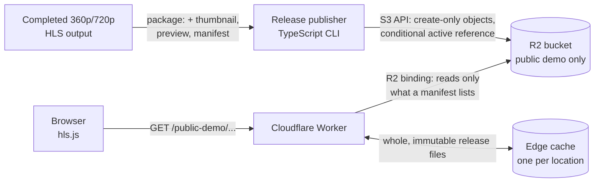

# Frameflow public demo at the edge

One owned sample video, delivered as adaptive HLS by a Cloudflare Worker in front of a dedicated R2 bucket. This directory holds the Worker, the release publisher that fills the bucket, and their tests. It is a separate package: nothing in it is imported by the Next.js app, the Fastify API or the Hatchet worker, and it never touches Frameflow's private storage.

- [How it fits together](#how-it-fits-together)
- [Run it locally](#run-it-locally)
- [Releases](#releases)
- [What the Worker serves](#what-the-worker-serves)
- [Cache behaviour per Cloudflare location](#cache-behaviour-per-cloudflare-location)
- [Staging](#staging)
- [Test matrix](#test-matrix)
- [Operating notes](#operating-notes)

## How it fits together



| Path | What it is |
| --- | --- |
| `src/shared/contract.ts` | The contract both sides import: key layout, the files a release may hold, the manifest and the active reference |
| `src/publisher/` | `package`, `publish`, `promote`, `rollback`, `status`, `verify` |
| `src/worker/` | The Worker and the demo player page it serves |
| `local/` | Builds the Worker and runs it in the real Workers runtime (workerd) with a local R2 bucket, for the tests and the demo |
| `scripts/local-demo.ts` | The whole thing on this machine |
| `scripts/edge-check.ts` | Checks a release through the Worker and records cache behaviour |
| `wrangler.jsonc` | The staging Worker. There is no production configuration here |

The bucket is laid out exactly as the URLs are:

```text
public-demo/active.json                        the active reference: the only object that ever changes
public-demo/releases/<release-id>/release.json the manifest, written last
public-demo/releases/<release-id>/master.m3u8
public-demo/releases/<release-id>/360p/index.m3u8, segment-000.ts, ...
public-demo/releases/<release-id>/720p/index.m3u8, segment-000.ts, ...
public-demo/releases/<release-id>/thumbnail.jpg
public-demo/releases/<release-id>/preview.mp4
```

## Run it locally

Needs Node.js 24 and FFmpeg. Nothing here contacts Cloudflare.

```bash
cd edge
npm ci
npm run verify          # typecheck, then the tests in the Workers runtime (workerd) with a local R2 bucket
npm run demo:local      # Worker + local R2 on http://127.0.0.1:8787/public-demo/
```

`demo:local` prints the four `PUBLIC_DEMO_S3_*` values of its local bucket. With them set, in a second terminal:

```bash
npm run release -- package --hls ../output/<a-completed-output> --label a --out .releases/a
npm run release -- publish .releases/a --promote
```

The local runtime simulates R2, R2's S3 API with conditional writes, and the Cache API. That proves the logic. It says nothing about Cloudflare's edge, which only staging can show.

## Releases

A release is one immutable set of files under its own prefix. Its ID is its label plus a digest of every file's path, size and SHA-256, for example `a-5f91a084af27c5c7`. Different content can therefore never claim an existing version path, and packaging the same content again gives the same ID.

**`package`** copies exactly what the playlists reference out of a completed pipeline output, checks that every rendition decodes, adds a thumbnail (a frame of the largest rendition) and a preview (a short muted H.264 clip of the smallest, which the player page plays on hover), and writes the manifest. The pipeline itself is not changed: the thumbnail and the preview are made here, from its output.

**`publish`** does five things in order, and a failure at any of them leaves the active release as it was:

1. Validate the package against its manifest: the master playlist, every variant playlist, every segment they reference, the thumbnail and the preview, by checksum. Nothing has been written yet.
2. Upload each object with `If-None-Match: *`. An object that exists is never replaced.
3. Read the whole release back from the bucket and validate that copy the same way, plus each object's stored content type and cache lifetime.
4. Only then create `release.json`. Until it exists the Worker serves nothing of the release, so a half-uploaded release is invisible.
5. With `--promote`, move the active reference.

**`promote`** and **`rollback`** change `active.json` with one conditional write: `If-Match` on the ETag that was read, or `If-None-Match: *` for the first release. If someone else changed the reference in between, the write fails and nothing is overwritten. `--expect-active <id>` also refuses to proceed unless that release is the active one. A rollback is a promotion of the previous release, so it uploads nothing and purges nothing.

The publisher never deletes and never overwrites. An interrupted publish is resumed by running it again: what already arrived is kept, and only the rest is uploaded. If a release's prefix holds something that is not the release, the publish stops there and stays stopped, and the way out is to package the same content under another label, which is another version path.

| Guarantee | How it is kept |
| --- | --- |
| Versioned media is never overwritten or removed | The publisher has no unconditional write and no delete. Objects are created with `If-None-Match: *`, and the ID is derived from the content |
| A failed publish leaves the old release active | The active reference is written last, after the bucket copy has been validated |
| A release is all there or not there at all | The manifest is the commit marker, and the Worker serves only what a manifest lists |
| Two operators cannot overwrite each other | The active reference is replaced only with `If-Match` on the ETag that was read |
| A playlist cannot bring in a file nobody validated | The playlist reader accepts only the tags the pipeline writes, in plain ASCII with LF or CRLF line ends, and segment and variant names of the release's own form. Comments, unknown tags and attributes, other line breaks and absolute URLs fail the release |
| The publisher cannot reach private media | It reads only `PUBLIC_DEMO_S3_*`, accepts only a bucket named `*public-demo*` on an endpoint without a path, and refuses every key outside `public-demo/` |

## What the Worker serves

Only `GET`, `HEAD` and `OPTIONS`, and only under `/public-demo/`:

| URL | Answer | Cache-Control |
| --- | --- | --- |
| `/public-demo/` | The demo player page | `no-store` |
| `/public-demo/current.json` | The active release: ID, playlist, thumbnail and preview URLs | `no-store` |
| `/public-demo/current.m3u8` | `302` to the active release's master playlist, for any HLS player | `no-store` |
| `/public-demo/releases/<id>/<file>` | A release file, if a published manifest lists it | `public, max-age=31536000, immutable` |
| anything else | `404`, or `405` for other methods | `no-store` |

Content types come from the file's place in the release, not from stored metadata: `application/vnd.apple.mpegurl` for playlists, `video/mp2t` for segments, `image/jpeg` for the thumbnail and `video/mp4` for the preview.

What is deliberately out of reach:

- **Private media.** The Worker's only binding is the public demo bucket. It has no credentials, no secrets, and no route to the MinIO or S3 bucket that holds uploads and private streams. Authenticated playback stays where it was, behind the API.
- **Anything unlisted.** A file is served only when the manifest of a complete release lists it. An object that merely sits in the bucket, a release without a manifest, the manifests themselves and the stored `active.json` all answer `404`.
- **Anything that writes.** There is no publish, promote or purge endpoint. Releases change only through the publisher, with bucket credentials the Worker does not have.
- **Query strings**, except on the player page. On a release file they would only multiply cache keys.

On every read from the bucket the Worker compares the object's size and MD5 with the manifest. An object that is not the published one answers `502` and is not cached.

## Cache behaviour per Cloudflare location

The Worker caches release files with the Cache API. That cache is local to each Cloudflare data center: it is not replicated and not tiered, so every location warms up on its own.

| Request | What happens at that location | `x-frameflow-cache` |
| --- | --- | --- |
| First request for a release file | The Worker reads R2, streams the object to the viewer, and stores the whole object in this location's cache | `MISS` |
| Repeat request, same location | Served from this location's cache. R2 is not read. Cloudflare adds `cf-cache-status: HIT` | `HIT` |
| Same file, another location | That location has its own cache, so its first request is a `MISS` | `MISS` |
| `Range` request, object cached here | `206`, cut by the Worker from the whole object the cache holds | `HIT` |
| `Range` request, object not cached here | `206` straight from R2, not stored. The whole object is then fetched once in the background and stored | `MISS` |
| `current.json`, `current.m3u8` | Read from R2 on every request. Never stored, here or downstream | `BYPASS` |
| Errors and everything else | Never stored | `BYPASS` |

Each response also carries `x-frameflow-colo`, the location that answered, so a first and a repeat request can be shown to have met at the same place.

- **No partial response is ever stored as a whole object.** Only complete `200` responses are put in the cache, each through a stream that fails unless it carries exactly the manifest's byte count. A `206` is never stored.
- **A hit and a miss answer alike.** The cache is only ever asked for the whole object, with no `Range` and no validators. One function in the Worker then decides what the request gets, whether the object came from the cache or from R2: the range, `416`, `304`, or the headers for `HEAD`. A range the Worker cannot use is ignored and the whole object is sent, as HTTP allows.
- **Rollback needs no purge.** The active reference is never cached, and R2 is strongly consistent, so the next request anywhere sees a promotion or a rollback. Release files never change, so nothing cached can be stale.
- **A long TTL is a ceiling, not a promise.** A location may evict an object early. The next request there is a `MISS` and reads R2 again.
- **Browsers cache too.** A release file is immutable for a year, so a browser that has it does not ask again. The player page marks those rows `BROWSER`.
- **The tiered cache in front of Workers stays off** (`"cache": { "enabled": false }` in `wrangler.jsonc`), so there is exactly one edge cache to reason about, and it is per location.

### What Cloudflare's edge was seen to do

Measured on 2026-11-22 at the FRA location, with a temporary probe Worker on the staging account's `workers.dev` hostname. The probe had no R2 binding and was deleted afterwards. These are the properties of the edge that the design above relies on:

| Observation | Consequence here |
| --- | --- |
| A response stored with the Cache API came back on the repeat request with `cf-cache-status: HIT`, the same body and a growing `age`. The same response without the Cache API was regenerated every time | The Cache API works on `workers.dev`, and nothing is cached unless the Worker stores it |
| Asked with a `Range` or an `If-None-Match` header, the cache answered for a stored object with `206` and `304` by its own rules | The Worker does not hand it those headers: it asks for the whole object and applies its own rules, the same ones as on a miss |
| A stream that closed after 500 of a declared 1000 bytes **was stored**, and served as a complete `200` of 500 bytes | Without a guard, a truncated read would be cached as a whole object |
| The same stream through `FixedLengthStream(1000)` made the put fail, and nothing was stored | That is the guard the Worker uses |
| Storing a `206` threw, and storing a `no-store` response stored nothing | Partial and uncacheable responses cannot be put by accident |
| A stored entry was still a `HIT` after a new version of the Worker was deployed | A deploy does not clear the cache: see `CACHE_EPOCH` below |

## Staging

Staging is a Worker on its `workers.dev` hostname and one R2 bucket. It needs no DNS record, and `wrangler.jsonc` defines nothing else: no production Worker, route or domain. One sample is a few megabytes and a handful of requests, far inside R2's free allowance.

Once, by the account owner:

1. Enable R2 for the account in the Cloudflare dashboard.
2. Create an R2 API token with **Object Read & Write**, limited to the bucket `frameflow-public-demo-staging`.
3. Put its endpoint and keys in `edge/.env.staging`, which Git ignores: `cp .env.example .env.staging && chmod 600 .env.staging`. Never paste the keys into a chat, a ticket or a commit.

Then:

```bash
npx wrangler r2 bucket create frameflow-public-demo-staging   # the dedicated bucket. It is private: no r2.dev URL, no custom domain
npm run deploy:staging                                        # prints the workers.dev URL

npm run release -- package --hls ../output/<completed-output> --label a --out .releases/a
npm run release:staging -- publish .releases/a                # upload, verify, commit. Not active yet
npm run edge:check -- --origin https://<worker-host> --package .releases/a --label staging --out .evidence/staging-a
npm run release:staging -- promote <release-a-id> --expect-active none
```

`edge:check` requests every file twice and reports the first and the repeat request, the location that answered, a ranged request, and a list of paths that must answer `404`. Run it straight after `publish`: a file that has already been requested at a location can only show repeats. It writes its evidence to `.evidence/`, without the hostname and with an allowlist of headers.

To prove that a private or unlisted object cannot be served, plant two canaries with `wrangler` (the publisher refuses to write them), run `edge:check`, which probes both paths, and delete them:

```bash
printf 'canary: must never be served\n' > canary.txt
npx wrangler r2 object put frameflow-public-demo-staging/private/canary.txt --file canary.txt --remote
npx wrangler r2 object put "frameflow-public-demo-staging/public-demo/releases/<release-a-id>/unlisted-canary.ts" --file canary.txt --remote
npm run edge:check -- --origin https://<worker-host> --package .releases/a --label staging
npx wrangler r2 object delete frameflow-public-demo-staging/private/canary.txt --remote
npx wrangler r2 object delete "frameflow-public-demo-staging/public-demo/releases/<release-a-id>/unlisted-canary.ts" --remote
```

## Test matrix

`npm test` runs these locally, against the built Worker in workerd, with the publisher writing over the local S3 endpoint and the Worker reading through its R2 binding. The staging column is filled in from a staging run, and stays empty until one has happened.

| # | Scenario | Expected | Local | Staging |
| --- | --- | --- | --- | --- |
| 1 | Publish A and promote it | A's version URLs serve, `current.json` names A | pass | not run |
| 2 | Play A: every playlist, segment, thumbnail and preview, whole and from the middle | `200` with the manifest's checksum, `206` with the right bytes | pass | not run |
| 3 | Failed publish: B's playlist references a missing segment | Refused before any upload. A active and seekable | pass | not run |
| 4 | Failed publish: a file changed after packaging | Refused before any upload. A active and seekable | pass | not run |
| 5 | Failed publish: upload interrupted (`--interrupt-after`) | B's objects exist but answer `404`. `promote B` refused. A active and seekable | pass | not run |
| 6 | Failed publish: an object at one of the release's keys is not the release's, or is stored with the wrong type | Not committed, nothing overwritten. A active and seekable. The same content publishes under another label | pass | not run |
| 7 | Resume B after the interruption | Only the missing objects are uploaded. B serves at its version URLs, A still active | pass | not run |
| 8 | Promote B | `current.json` names B on the next request, with A's files still cached. No purge | pass | not run |
| 9 | Roll back to A | `current.json` names A on the next request. B's version URLs still serve | pass | not run |
| 10 | Promotion that lost a race, or with a wrong `--expect-active` | Nothing written. Two promotions of the same release: one write, no error | pass | not run |
| 11 | Publish A again, or forge A's ID for other content | Nothing written, refused | pass | not run |
| 12 | First and repeat request for each file | `MISS`, then `HIT` at the same location | pass (simulated cache) | not run |
| 13 | Ranged first request | `206`, not stored. The cache then holds the whole object | pass (simulated cache) | not run |
| 13a | The same range, `HEAD`, `If-None-Match` and `If-Range` requests on a miss and on a hit | The same status, headers and bytes both times | pass (simulated cache) | not run |
| 14 | Private and unlisted objects planted in the bucket, traversal, other methods, query strings | `404` or `405`, never the object | pass | not run |
| 15 | Object in the bucket differs from the manifest | `502`, not cached | pass | not run |
| 16 | Real player: play, seek back and forward, hover preview | Plays to the end, seeks land and keep playing, preview plays on hover | pass (Chromium, hls.js 1.7.3, by hand) | not run |

## Operating notes

- **Rehearsing a failure.** `publish --interrupt-after <n>` stops after `n` uploads, as a lost connection would. It can only make a publish stop early.
- **Leftovers.** The objects of a release that never completed are not served and cost only their storage. No command removes them. To remove them by hand, with `wrangler r2 object delete` or in the dashboard, first make sure no publish of that release is running, and never touch a release that `status` shows as complete.
- **Taking a release down** is not a rollback and is the one thing that needs more than a pointer change: delete its objects, then raise `CACHE_EPOCH` in `wrangler.jsonc` and deploy. The epoch is part of every cache key, so every location starts cold. A Worker deploy alone does not clear the cache.
- **Cost surface.** A cache `HIT` reads nothing from R2. A `MISS` reads the manifest once per Worker isolate and the object once, or twice for a ranged miss: the range for the viewer, then the whole object for the cache. `current.json` and a request for an unknown release each read R2 once, every time, by design. Every request, hit or not, is one Worker invocation.
- **Logs.** The Worker logs one JSON line per release-file request: release, path, status, cache state and location. It logs nothing about the client. With `observability` on, Cloudflare also keeps its own invocation logs for the account.
- **Size.** The publisher holds a file in memory to hash it, and the Worker tees a body into the cache, so one file is limited to 64 MiB. HLS segments are far below that.
- **The player page** loads hls.js 1.7.3, the engine under the application's Video.js player, from jsDelivr with a Subresource Integrity hash. A test checks that hash against the hls.js package in `package-lock.json`. Its Content-Security-Policy allows that file, the page's own inline script and style by hash, and nothing else.
